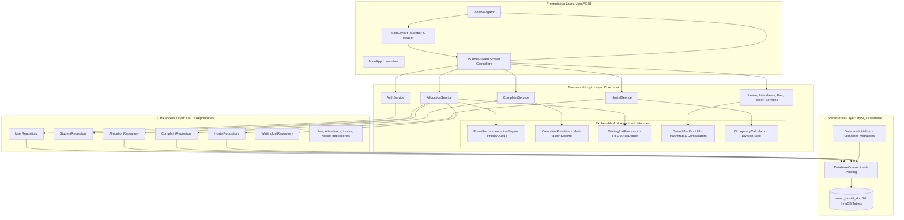

# Software Architecture & Engineering Design
## Smart Hostel Management System — CSE203

---

## 1. System Overview & Layered Architecture

The **Smart Hostel Management System** follows a strict **N-Tier Layered Architecture** adhering to the **Separation of Concerns (SoC)** principle. The application separates UI presentation, business operations, data persistence, and security controls into distinct decoupled packages without relying on heavy enterprise frameworks like Spring Boot.



---

## 2. Object-Oriented Programming (OOP) Principles Mapping

The core academic objective of this project is demonstrating concrete mastery of Object-Oriented Programming in Java.

### A. Inheritance (`extends`)
- **Abstract Base Class:** `User` defines core identity attributes: `id`, `username`, `passwordHash`, `fullName`, `email`, `phone`, `role`, `active`, and `createdAt`.
- **Concrete Subclasses:**
  - `Administrator`: Inherits from `User`, manages institutional configuration.
  - `Warden`: Inherits from `User`, holds `assignedBlockName` and operational authority.
  - `Student`: Inherits from `User`, holds `studentRecordId`, `registerNumber`, `department`, `year`, `guardianName`, and `guardianPhone`.

### B. Polymorphism (`@Override` & Dynamic Method Dispatch)
- The base class `User` declares the polymorphic method:
  ```java
  public abstract String getRoleDescription();
  ```
- Subclasses override this method to provide role-specific behaviors at runtime:
  - `Administrator`: Returns `"System Administrator — full access to manage the hostel system"`
  - `Warden`: Returns `"Hostel Warden — manages students, allocations, complaints, and attendance"`
  - `Student`: Returns `"Student — " + department + ", Year " + year`
- In `SessionManager` and `MainLayout`, code interacts with the polymorphic `User` reference without needing to inspect low-level instance types.

### C. Encapsulation
- All instance variables in models, services, and repositories are declared `private` or `protected`.
- Mutation is strictly controlled through getter and setter methods that validate boundary conditions.
- For example, `InputValidator` checks that email formats conform to RFC regex standards, phone numbers contain 10-12 numeric digits, and fee amounts are strictly positive before states are modified.

### D. Abstraction & Interface Segregation
- The data layer abstracts raw SQL mechanics away from UI controllers. A screen never writes a `PreparedStatement` or handles a `ResultSet`; it calls `AllocationService.allocateBed(studentId, bedId, remarks)`.
- If the database dialect or storage engine changes in the future, the presentation layer remains completely unaffected.

### E. Composition vs. Aggregation Hierarchy
The structural model reflects real-world physical hostel relationships:
- **Composition (Strict Life-cycle Dependency):**
  - A `Hostel` contains multiple `Block`s.
  - A `Block` contains multiple `Floor`s.
  - A `Floor` contains multiple `Room`s.
  - A `Room` contains multiple `Bed`s.
  - Deleting a Block cascades to its Floors, Rooms, and Beds.
- **Aggregation (Loose Associative Association):**
  - An `Allocation` associates an independent `Student` with an independent `Bed`. If an allocation ends, neither the Student account nor the physical Bed is destroyed.

---

## 3. Data Structures & Algorithmic Design

### Data Structure 1: Hash-Based Indexing (`HashMap`)
- **Location:** `com.hostelmanagement.algorithms.SearchAndSortUtil`
- **Application:** Indexing hundreds of student records by their uppercase `registerNumber`.
- **Time Complexity:** Average $O(1)$ constant time lookup compared to $O(n)$ linear iteration across list views.

### Data Structure 2: Priority Ranking (`PriorityQueue`)
- **Location:** `com.hostelmanagement.ai.RoomRecommendationEngine`
- **Application:** Evaluates available beds against student preferences. Beds are added to a binary min/max-heap `PriorityQueue<RoomRecommendation>` based on their computed suitability score.
- **Time Complexity:** $O(\log n)$ insertion, retrieving top recommendations in sorted priority order without sorting the entire collection repeatedly.

### Data Structure 3: Fair FIFO Queue (`ArrayDeque`)
- **Location:** `com.hostelmanagement.algorithms.WaitingListProcessor`
- **Application:** When all beds are occupied, students enter a first-in, first-out waiting list backed by a `Queue<WaitingListEntry>`.
- **Integrity Validation:** When a bed becomes free, the processor checks if the front student has already secured a room elsewhere. If so, they are safely skipped to ensure strict fairness.

### Algorithm 1: Rule-Based Explainable AI Room Recommendation
- **Scoring Function:**
  $$\text{Score} = \text{Base}(50) + \text{BlockMatch}(25) + \text{FloorMatch}(15) + \text{GroundFloorBonus}(5)$$
- **Explainability:** Generates a human-readable string justifying the rank (e.g., *"Matches preferred block (Block A); Matches preferred floor (Floor 1); Convenient ground access."*).

### Algorithm 2: Dynamic Complaint Prioritization & Backlog Escalation
- **Scoring Function:**
  $$\text{Score} = \text{CategoryBase}(10\text{--}35) + \text{Urgency}(7 \times [1..5]) + \text{Impact}(4 \times [1..5]) + \text{Aging}(0.5 \times \text{Hours})$$
- **Classification:**
  - $\text{Score} \ge 70$: **CRITICAL** (Emergency utility/safety)
  - $\text{Score} \ge 50$: **HIGH** (Severe disruption)
  - $\text{Score} \ge 30$: **MEDIUM** (General repairs)
  - $\text{Score} < 30$: **LOW** (Minor aesthetic/furniture)

### Algorithm 3: Division-by-Zero Protected Occupancy Calculator
- **Formula:**
  $$\text{Occupancy Rate} = \begin{cases} \left(\frac{\text{Occupied}}{\text{Usable}}\right) \times 100 & \text{if Usable} > 0 \\ 0.0 & \text{if Usable} = 0 \end{cases}$$
- Filters out beds under maintenance (`UNDER_MAINTENANCE`) so institutional utilization stats are accurate and division by zero is impossible.

---

## 4. Concurrency Protection & Transaction Safety

To prevent double-booking of beds when two wardens attempt to allocate the same bed simultaneously:
1. All allocation operations execute inside an explicit database transaction with auto-commit disabled: `conn.setAutoCommit(false)`.
2. The bed's current status is queried with **Pessimistic Locking**:
   ```sql
   SELECT status FROM beds WHERE id = ? FOR UPDATE;
   ```
3. If the bed is already `OCCUPIED`, an `AllocationConflictException` is thrown, and `conn.rollback()` restores state.
4. If available, the bed status is updated to `OCCUPIED`, the `allocations` record is created, and `conn.commit()` atomizes both operations.

---

## 5. Security Architecture

1. **Password Storage:** Passwords are never stored in plaintext. They are hashed using **PBKDF2 with HMAC-SHA256**:
   - `iterations = 65,536`
   - Cryptographically random 16-byte salt per user generated via `SecureRandom`
   - Result formatted as: `iterations:base64(salt):base64(hash)`
2. **Timing Attack Protection:** Hash verification uses constant-time byte comparison (`slowEquals`) to prevent timing side-channel attacks.
3. **Session Management:** Centralized `SessionManager` tracks active authenticated users in memory with thread-safe controls.
4. **Role Enforcement:** Navigation to management screens is guarded by role checks; unauthorized access attempts are redirected to default views with warning alerts.
