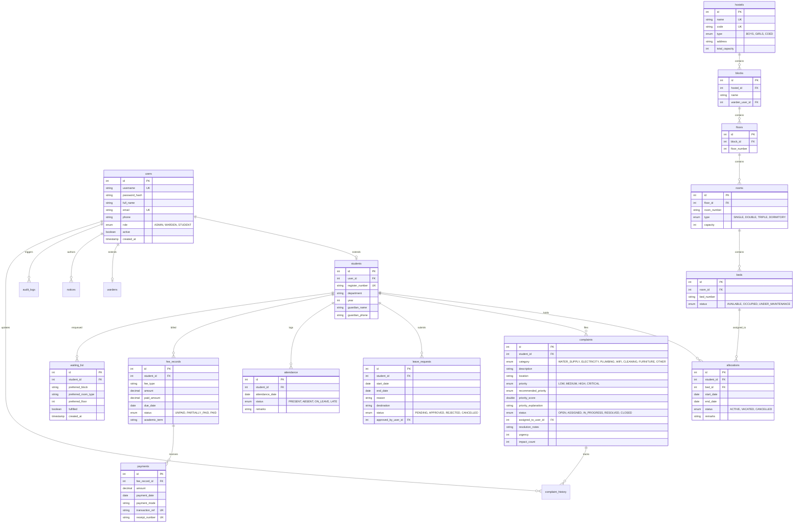

# Database Schema & Relational Model
## Smart Hostel Management System (`smart_hostel_db`)

---

## 1. Overview & Technical Specs

- **Database Engine:** MySQL 8.0+ (InnoDB Storage Engine)
- **Default Character Set:** `utf8mb4` (full multilingual & emoji support)
- **Collation:** `utf8mb4_unicode_ci`
- **ACID Support:** Strict transactional consistency with foreign key constraints, unique indexes, and row-level locking (`SELECT FOR UPDATE`).
- **Migration Strategy:** Automated versioned migrations managed by `DatabaseInitializer` using the `schema_version` tracking table. No manual table generation required.

---

## 2. Mermaid Entity-Relationship Diagram (ERD)

---

## 3. Relational Data Dictionary

### 1. `schema_version`
Tracks versioned migration scripts to ensure startup scripts are idempotent.
| Column | Type | Constraints | Description |
| :--- | :--- | :--- | :--- |
| `version` | INT | PRIMARY KEY | Sequential migration number |
| `description` | VARCHAR(255) | NOT NULL | Human-readable migration description |
| `applied_at` | TIMESTAMP | DEFAULT CURRENT_TIMESTAMP | Date and time executed |

### 2. `users`
Master table for all system identities.
| Column | Type | Constraints | Description |
| :--- | :--- | :--- | :--- |
| `id` | INT | AUTO_INCREMENT, PK | Unique user identifier |
| `username` | VARCHAR(50) | NOT NULL, UNIQUE | Login credential |
| `password_hash` | VARCHAR(255) | NOT NULL | PBKDF2WithHmacSHA256 salted hash |
| `full_name` | VARCHAR(100) | NOT NULL | Full display name |
| `email` | VARCHAR(100) | NOT NULL, UNIQUE | Contact email address |
| `phone` | VARCHAR(20) | NULL | 10-12 digit mobile number |
| `role` | ENUM | NOT NULL | `ADMIN`, `WARDEN`, or `STUDENT` |
| `active` | BOOLEAN | DEFAULT TRUE | Account state |
| `created_at` | TIMESTAMP | DEFAULT CURRENT_TIMESTAMP | Account registration date |

### 3. `hostels`
Hostel buildings on campus.
| Column | Type | Constraints | Description |
| :--- | :--- | :--- | :--- |
| `id` | INT | AUTO_INCREMENT, PK | Unique hostel ID |
| `name` | VARCHAR(100) | NOT NULL, UNIQUE | Hostel name (e.g., Everest Boys Hostel) |
| `code` | VARCHAR(20) | NOT NULL, UNIQUE | Short code (e.g., EBH) |
| `type` | ENUM | NOT NULL | `BOYS`, `GIRLS`, or `COED` |
| `address` | VARCHAR(255) | NULL | Campus location |
| `total_capacity`| INT | DEFAULT 0 | Maximum accommodation capacity |

### 4. `blocks`
Physical wings or blocks within a hostel.
| Column | Type | Constraints | Description |
| :--- | :--- | :--- | :--- |
| `id` | INT | AUTO_INCREMENT, PK | Block identifier |
| `hostel_id` | INT | NOT NULL, FK(`hostels.id`) | Owning hostel |
| `name` | VARCHAR(50) | NOT NULL | Block name (e.g., Block A, East Wing) |
| `warden_user_id`| INT | NULL, FK(`users.id`) | Assigned supervisor warden |

### 5. `floors`
Floors within a block.
| Column | Type | Constraints | Description |
| :--- | :--- | :--- | :--- |
| `id` | INT | AUTO_INCREMENT, PK | Floor identifier |
| `block_id` | INT | NOT NULL, FK(`blocks.id`) | Owning block |
| `floor_number` | INT | NOT NULL | Floor index (0 = Ground, 1 = 1st) |

### 6. `rooms`
Rooms located on a floor.
| Column | Type | Constraints | Description |
| :--- | :--- | :--- | :--- |
| `id` | INT | AUTO_INCREMENT, PK | Room identifier |
| `floor_id` | INT | NOT NULL, FK(`floors.id`) | Floor reference |
| `room_number` | VARCHAR(20) | NOT NULL | Room code (e.g., 101, 204B) |
| `room_type` | ENUM | NOT NULL | `SINGLE`, `DOUBLE`, `TRIPLE`, `DORMITORY` |
| `capacity` | INT | NOT NULL | Maximum beds supported |

### 7. `beds`
The atomic allocatable resource in the system.
| Column | Type | Constraints | Description |
| :--- | :--- | :--- | :--- |
| `id` | INT | AUTO_INCREMENT, PK | Bed identifier |
| `room_id` | INT | NOT NULL, FK(`rooms.id`) | Room reference |
| `bed_number` | VARCHAR(20) | NOT NULL | Bed code (e.g., Bed-1, Bed-A) |
| `status` | ENUM | NOT NULL | `AVAILABLE`, `OCCUPIED`, `UNDER_MAINTENANCE` |

### 8. `students`
Student-specific profile table.
| Column | Type | Constraints | Description |
| :--- | :--- | :--- | :--- |
| `id` | INT | AUTO_INCREMENT, PK | Student profile identifier |
| `user_id` | INT | NOT NULL, UNIQUE, FK(`users.id`) | Linked authentication account |
| `register_number`| VARCHAR(50) | NOT NULL, UNIQUE | University register number |
| `department` | VARCHAR(100) | NOT NULL | Academic branch (e.g. CSE, ECE) |
| `year` | INT | NOT NULL | Current academic year (1-4) |
| `guardian_name` | VARCHAR(100) | NULL | Parent/guardian name |
| `guardian_phone`| VARCHAR(20) | NULL | Emergency guardian contact |

### 9. `allocations`
Tracks bed tenancy records and room allocations.
| Column | Type | Constraints | Description |
| :--- | :--- | :--- | :--- |
| `id` | INT | AUTO_INCREMENT, PK | Allocation identifier |
| `student_id` | INT | NOT NULL, FK(`students.id`) | Student occupant |
| `bed_id` | INT | NOT NULL, FK(`beds.id`) | Assigned bed |
| `start_date` | DATE | NOT NULL | Check-in / allocation date |
| `end_date` | DATE | NULL | Check-out date |
| `status` | ENUM | NOT NULL | `ACTIVE`, `VACATED`, `CANCELLED` |
| `remarks` | TEXT | NULL | Special conditions / remarks |

### 10. `complaints`
Student grievances with rule-based AI triage scoring.
| Column | Type | Constraints | Description |
| :--- | :--- | :--- | :--- |
| `id` | INT | AUTO_INCREMENT, PK | Complaint ticket identifier |
| `student_id` | INT | NOT NULL, FK(`students.id`) | Submitting resident |
| `category` | ENUM | NOT NULL | `WATER_SUPPLY`, `ELECTRICITY`, `PLUMBING`, etc. |
| `description` | TEXT | NOT NULL | Problem narrative |
| `location` | VARCHAR(100) | NOT NULL | Room/block details |
| `priority` | ENUM | NOT NULL | `LOW`, `MEDIUM`, `HIGH`, `CRITICAL` |
| `recommended_priority`| ENUM | NULL | AI algorithmic recommendation |
| `priority_score`| DOUBLE | NULL | Calculated urgency/impact score (0-100) |
| `priority_explanation`| TEXT | NULL | Human-readable explanation of AI score |
| `status` | ENUM | NOT NULL | `OPEN`, `ASSIGNED`, `IN_PROGRESS`, `RESOLVED`, `CLOSED` |
| `assigned_to_user_id`| INT | NULL, FK(`users.id`) | Staff assignee |
| `resolution_notes`| TEXT | NULL | Completion or repair report |

---

## 4. Key Relational Integrity & Performance Rules

1. **Foreign Key Cascades:** Deleting a `Hostel` cascades deletions down to `Blocks`, `Floors`, `Rooms`, and `Beds`. Deleting a student never deletes historic financial `payments` or completed `audit_logs`.
2. **Composite Indexes:**
   - `idx_beds_room_status` (`room_id`, `status`): Accelerates finding available beds during room recommendations.
   - `idx_allocations_active` (`student_id`, `status`): Speeds up validation preventing a student from obtaining dual active beds.
   - `idx_attendance_student_date` (`student_id`, `attendance_date`): Accelerates monthly attendance percentage calculations.
3. **Pessimistic Concurrency (`SELECT FOR UPDATE`):** Bed reservations lock the target bed row inside an active transaction to guarantee zero double-bookings under multi-user concurrency.
